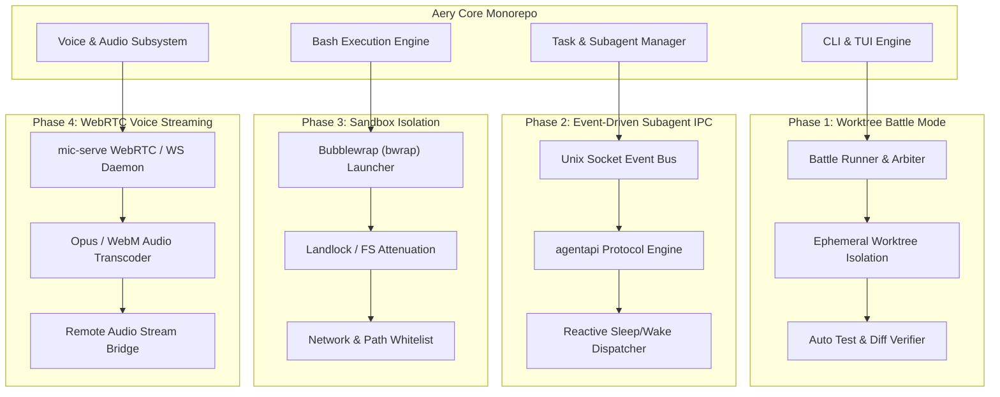

# Implementation Plan: Enhancing Aery with Antigravity (AGY) Architectural Features

I am using the `writing-plans` skill to create a comprehensive, production-grade implementation plan to incorporate the best architectural capabilities of Google Antigravity (`agy`) into `aery`.

---

## 1. Overview & Architecture Goals

This plan targets four critical capabilities identified from our deep binary analysis of `agy`:

---

## 2. File & Module Structure

| Target Subsystem | Files to Create / Modify | Responsibility |
| :--- | :--- | :--- |
| **1. Worktree Battle Mode** | `packages/coding-agent/src/battle/types.ts` `packages/coding-agent/src/battle/battle-runner.ts` `packages/coding-agent/src/tools/battle.ts` `packages/coding-agent/src/cli/battle-cli.ts` | Orchestrate parallel speculative branches, execute automated tests across worktrees, score solutions, and merge the winner. |
| **2. Event-Driven Subagent IPC** | `packages/coding-agent/src/ipc/agent-bus.ts` `packages/coding-agent/src/ipc/agentapi-cli.ts` `packages/coding-agent/src/task/reactive-scheduler.ts` | Provide an asynchronous Unix domain socket event bus, non-polling reactive wakeups, and an `agy agentapi` CLI bridge. |
| **3. Sandbox Isolation** | `packages/coding-agent/src/sandbox/types.ts` `packages/coding-agent/src/sandbox/bwrap-driver.ts` `packages/coding-agent/src/exec/bash-executor.ts` (modify) | Wrap terminal command execution in Linux namespaces/bubblewrap with read-only root and workspace-confined writes. |
| **4. WebRTC Voice Streaming** | `packages/coding-agent/src/voice/webrtc-serve.ts` `packages/coding-agent/src/voice/stream-protocol.ts` `packages/coding-agent/src/cli/voice-serve-cli.ts` | Host low-latency bidirectional WebRTC / WebSocket audio streaming for remote mic input (`aery mic-serve`). |

---

## 3. Bite-Sized Implementation Tasks

### Phase 1: Worktree Battle Mode (Speculative Multi-Model Execution)

- [ ] **Task 1.1: Battle Mode Core Data Models & Config**
  - Create `packages/coding-agent/src/battle/types.ts` defining `BattleConfig`, `BattleCandidate`, `CandidateRunResult`, and `DiffSummary`.
  - Add test in `packages/coding-agent/src/battle/__tests__/types.test.ts`.

- [ ] **Task 1.2: Worktree Lifecycle for Battle Candidates**
  - Implement `packages/coding-agent/src/battle/worktree-allocator.ts` using `packages/coding-agent/src/task/worktree.ts`.
  - Ensure candidate worktrees are created in `.aery/wt/battle-<id>-c<n>`, with baseline capture and automatic rollback/clean up.
  - Test creation, isolation, and teardown under simulated failure conditions.

- [ ] **Task 1.3: Candidate Agent Dispatch & Evaluation**
  - Implement `packages/coding-agent/src/battle/battle-runner.ts`:
    - Dispatch $N$ candidate agents with different models (e.g. Claude Sonnet vs Gemini Flash vs GPT-4o).
    - Run the verification test suite in each worktree upon agent completion.
    - Collect execution metrics (tests passed, tokens used, elapsed time, files modified).

- [ ] **Task 1.4: Battle Arbiter & Interactive Diff Picker**
  - Implement candidate selection logic: auto-select highest test score or render interactive TUI diff selector.
  - Add `packages/coding-agent/src/tools/battle.ts` exposing `battle_solve` tool to the agent.
  - Wire `--battle` flag in `packages/coding-agent/src/cli.ts`.

---

### Phase 2: Event-Driven Subagent IPC & `agentapi`

- [ ] **Task 2.1: Unix Domain Socket Message Bus**
  - Create `packages/coding-agent/src/ipc/agent-bus.ts`:
    - Initialize socket server at `~/.aery/run/aery-ipc-<session-id>.sock`.
    - Support typed messages: `agent.spawn`, `agent.message`, `agent.status`, `agent.yield`, `agent.complete`.
  - Write unit test verifying multi-client socket pub/sub.

- [ ] **Task 2.2: Reactive Task Scheduler (Eliminate Polling)**
  - Modify `packages/coding-agent/src/task/index.ts` to register waiting parent contexts with the bus.
  - When child agents yield or complete, emit event to immediately resume parent turn without interval timer polling.

- [ ] **Task 2.3: `aery agentapi` Subcommand**
  - Implement `packages/coding-agent/src/ipc/agentapi-cli.ts`:
    - `aery agentapi new-conversation --model=<model> "<prompt>"`
    - `aery agentapi send-message <recipient_id> "<content>"`
    - `aery agentapi get-conversation-metadata <conversation_id>`
  - Register `agentapi` in `packages/coding-agent/src/cli.ts`.

---

### Phase 3: Sandbox Isolation Engine (`--sandbox`)

- [ ] **Task 3.1: Sandboxing Detection & Capabilities Probe**
  - Create `packages/coding-agent/src/sandbox/types.ts` and `capabilities.ts`.
  - Check for `bwrap` (Bubblewrap), unprivileged user namespaces, or fallback Landlock support.

- [ ] **Task 3.2: Bubblewrap Argument Generator**
  - Create `packages/coding-agent/src/sandbox/bwrap-driver.ts`:
    - Mount `/` read-only (`--ro-bind / /`).
    - Mount temporary `/tmp` (`--tmpfs /tmp`).
    - Mount dev nodes (`--dev /dev`, `--proc /proc`).
    - Bind active workspace as read-write (`--bind <workspace> <workspace>`).
    - Drop network access if `--sandbox-no-net` is specified (`--unshare-net`).
  - Add test asserting correct CLI arg generation and protection of sensitive paths (e.g. `~/.ssh`, `~/.aws` read-protected or shadowed).

- [ ] **Task 3.3: Bash Executor Integration**
  - Modify `packages/coding-agent/src/exec/bash-executor.ts` to wrap shell command invocations with the sandbox driver when `settings.sandbox.enabled` or `--sandbox` is true.
  - Run verification test verifying that a command trying to touch `/etc` or files outside workspace fails with permission error.

---

### Phase 4: Low-Latency WebRTC Voice Streaming (`aery mic-serve`)

- [ ] **Task 4.1: Stream Protocol & Server Scaffolding**
  - Create `packages/coding-agent/src/voice/stream-protocol.ts` defining chunked audio frame envelope (16kHz PCM / Opus).
  - Create `packages/coding-agent/src/voice/webrtc-serve.ts` using WebSocket / WebRTC datachannel transport.

- [ ] **Task 4.2: Real-time Audio Ingestion Pipeline**
  - Connect inbound audio stream directly into `packages/coding-agent/src/voice/voice-daemon.ts` and Whisper STT engine.
  - Implement stream-level Voice Activity Detection (VAD) and barge-in interruption.

- [ ] **Task 4.3: `aery mic-serve` CLI Command**
  - Implement `packages/coding-agent/src/cli/voice-serve-cli.ts`:
    - Start local stream server on configured port (e.g. `8766`).
    - Print connection QR code / token for mobile or remote client.
  - Register `mic-serve` in `packages/coding-agent/src/cli.ts`.

---

## 4. Verification & Testing Strategy

1. **Unit Tests**:
   - `bun test packages/coding-agent/src/battle/`
   - `bun test packages/coding-agent/src/ipc/`
   - `bun test packages/coding-agent/src/sandbox/`
   - `bun test packages/coding-agent/src/voice/`
2. **Integration Verification**:
   - Run `aery --smoke-test` across all updated CLI verbs (`aery --help`, `aery agents`, `aery agentapi --help`, `aery mic-serve --help`).
   - Run a test Battle Mode session on a sample git repo.
   - Run a test command under `--sandbox` verifying filesystem containment.
