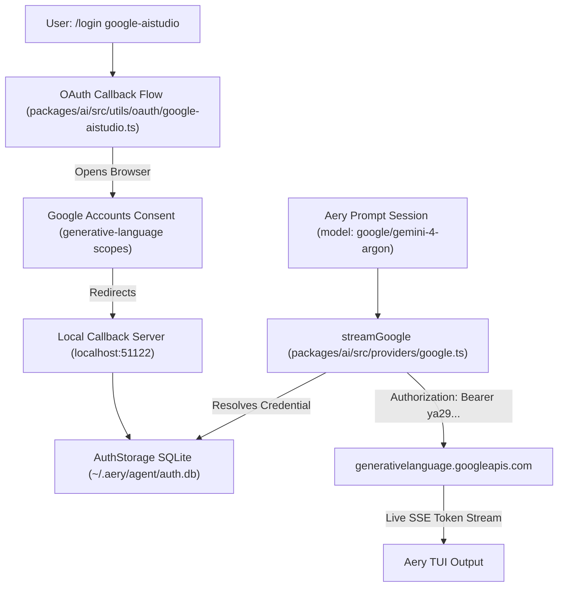

# Google AI Studio Web Auth Implementation Plan

Implement browser-based **Web Authentication** (OAuth 2.0 Web Login) for Google AI Studio in Aery so developers can authenticate directly with their Google Account and access **Gemini 4 Argon** (`gemini-4-argon`) and all AI Studio models without copying or pasting API keys.

---

## 1. User Review Required

> [!IMPORTANT]
> **Authentication Paradigm**: When the user types `/login google-aistudio` (or selects "Google AI Studio" in the `/login` menu), Aery will open their default browser, authenticate via Google's OAuth consent screen with Generative Language and Cloud Platform scopes, and store the resulting bearer token securely in Aery's SQLite `auth.db`.
>
> **Dual Authentication in `streamGoogle`**: The `google` provider in Aery will support **both**:
> 1. Web Auth Bearer Tokens (`Authorization: Bearer ya29...`)
> 2. Traditional API Keys (`x-goog-api-key: AIzaSy...`)

---

## 2. Architecture & File Decomposition



### Proposed Changes

| Component | File | Responsibility |
| :--- | :--- | :--- |
| **OAuth Flow** | [`packages/ai/src/utils/oauth/google-aistudio.ts`](packages/ai/src/utils/oauth/google-aistudio.ts) | Implementation of Google AI Studio OAuth login, PKCE/callback server, and token exchange. |
| **OAuth Registration** | [`packages/ai/src/utils/oauth/types.ts`](packages/ai/src/utils/oauth/types.ts) | Add `"google-aistudio"` to `OAuthProvider` union and metadata types. |
| **OAuth Registry** | [`packages/ai/src/utils/oauth/index.ts`](packages/ai/src/utils/oauth/index.ts) | Register `google-aistudio` provider info and login handlers in built-in OAuth providers. |
| **Provider Client** | [`packages/ai/src/providers/google.ts`](packages/ai/src/providers/google.ts) | Update request preparation to detect Bearer tokens (`ya29...`) and format `Authorization: Bearer` headers alongside `x-goog-api-key`. |
| **Model Registry** | [`packages/coding-agent/src/config/model-registry.ts`](packages/coding-agent/src/config/model-registry.ts) | Ensure `google-aistudio` OAuth credentials resolve for `google/*` models including `gemini-4-argon`. |
| **Automated Tests** | [`packages/ai/test/google-aistudio-oauth.test.ts`](packages/ai/test/google-aistudio-oauth.test.ts) | End-to-end unit tests verifying URL creation, token exchange handling, and header dispatch. |

---

## 3. Bite-Sized Implementation Tasks

### Task 1: Add `google-aistudio` to OAuth Types and Exports
- [ ] Add `"google-aistudio"` to `OAuthProvider` in `packages/ai/src/utils/oauth/types.ts`.
- [ ] Export `loginGoogleAiStudio` and `formatGoogleAiStudioApiKey` interfaces.

### Task 2: Create `google-aistudio.ts` OAuth Flow
- [ ] Implement `GoogleAiStudioOAuthFlow` using standard authorization-code flow:
  - Auth URL: `https://accounts.google.com/o/oauth2/v2/auth`
  - Token URL: `https://oauth2.googleapis.com/token`
  - Scopes:
    - `https://www.googleapis.com/auth/generative-language`
    - `https://www.googleapis.com/auth/cloud-platform`
    - `https://www.googleapis.com/auth/userinfo.email`
    - `https://www.googleapis.com/auth/userinfo.profile`
  - Callback Port: `51122` (dedicated distinct port).
  - Callback Path: `/oauth2callback`.
- [ ] Add token refresh logic for `google-aistudio` credentials.

### Task 3: Register `google-aistudio` in OAuth Registry
- [ ] Update `packages/ai/src/utils/oauth/index.ts`:
  - Add `{ id: "google-aistudio", name: "Google AI Studio (Gemini 4 Argon, Gemini 2.5)", available: true }` to `builtInOAuthProviders`.
  - Wire `loginGoogleAiStudio` into `loginOAuthProvider()`.
  - Wire `refreshGoogleAiStudioToken` into `refreshOAuthToken()`.

### Task 4: Upgrade `streamGoogle` for Bearer Token Authentication
- [ ] Update `packages/ai/src/providers/google.ts`:
  - Check if the resolved token is an OAuth token (`ya29...` or from `google-aistudio`).
  - If Bearer token: dispatch `Authorization: Bearer ${token}`.
  - If API key: dispatch `x-goog-api-key: ${apiKey}`.
  - Maintain compatibility with existing environment variable fallbacks.

### Task 5: Link Model Registry for `google-aistudio`
- [ ] In `packages/coding-agent/src/config/model-registry.ts`:
  - Allow `google-aistudio` credentials to satisfy `google` provider model requests when `GEMINI_API_KEY` is not present.
  - Ensure `gemini-4-argon` resolves to the newly authorized bearer token.

### Task 6: Unit Tests and Verification
- [ ] Create `packages/ai/test/google-aistudio-oauth.test.ts` testing:
  - Scope formatting in auth URL.
  - Bearer header injection when token begins with `ya29.`.
  - API key header fallback when key begins with `AIza`.
- [ ] Run test suite with `bun test packages/ai/test/google-aistudio-oauth.test.ts`.
- [ ] Build packages and verify TypeScript compilation cleanly passes.

---

## 4. Verification & Testing Evidence

1. Run Bun tests:
   ```bash
   cd packages/ai && bun test test/google-aistudio-oauth.test.ts
   ```
2. Verify Aery provider listing:
   ```bash
   aery --help
   ```
3. Test interactive `/login` menu displays `Google AI Studio (Gemini 4 Argon, Gemini 2.5)`.
